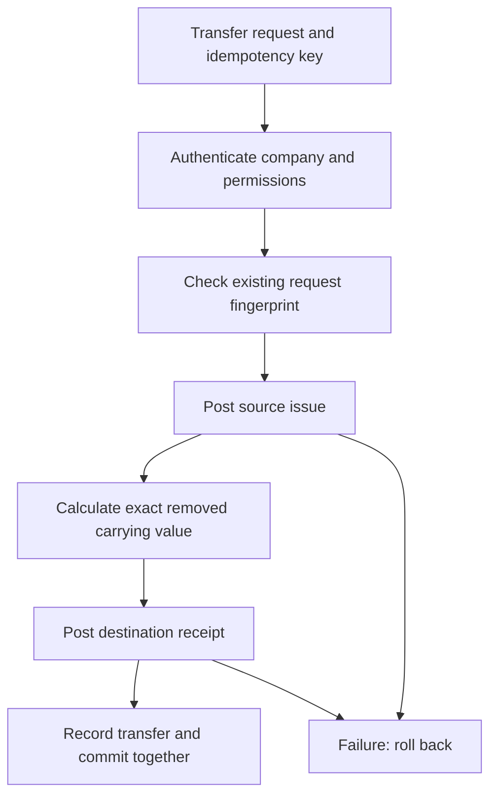

# Inventory Management System

I built an inventory and purchasing application on a reusable business portal foundation. My aim was to make the current stock balance explainable: every receipt, issue, adjustment and transfer should be backed by a recorded business operation rather than an unexplained number on a screen.

## The problem

**Stock balances are difficult to trust without a reliable movement history.**

A quantity on screen cannot explain whether stock was received, issued, adjusted or transferred. A retried request could create a duplicate movement, while a partially completed transfer could leave two locations with inconsistent balances.

Purchasing and replenishment introduce more points where quantities, supplier records and stock history must agree.

## The solution

**Traceable stock movements across locations and purchasing**

The application brings together item catalogues, locations, stock receipts and issues, stock counts, reorder thresholds, suppliers, purchase orders, partial receiving, multi-location transfers and operational reports. The interface also provides search, filters, role-sensitive views and CSV onboarding workflows.

The recorded demonstration shows stock views, reorder planning, purchase orders, transfers, suppliers and reporting. It uses a demonstration environment rather than customer transaction data.

## Engineering decisions

### 1. Post movements through an authoritative stock service

I kept stock transactions behind backend services instead of allowing the browser to update a balance directly. Each operation validates the authenticated company, item/location relationships, permitted action and quantities before posting a movement. Quantities and carrying values use decimal arithmetic.

### 2. Make a transfer one transaction, not two unrelated edits

For an immediate location transfer, the service posts an outgoing issue and an incoming receipt through the same authoritative ledger path. It derives the destination's carrying value from the **exact value removed** from the source. If either leg fails, the surrounding database transaction can roll both back.

A transfer has an idempotency key and a fingerprint of its request. A repeated request with identical data resolves to the existing transfer; the same key with different details raises a conflict. The service also rejects a ledger-key collision with an unrelated stock operation, so it cannot mistake a previously posted standalone movement for a transfer leg.

### 3. Control writes and protect organisation boundaries

Writes use company-scoped locking, with PostgreSQL row locks on stock balances in the underlying stock service. Compound tenant relationships and server-side permission checks protect company-specific records; role-restricted cost information is withheld from Member responses.

A company-wide lock is a deliberate simplicity trade-off. It protects consistency for this scale, but I would evaluate narrower locking if concurrency requirements grew.

### 4. Keep purchasing and importing accountable

Supplier orders have explicit lifecycle rules; receiving quantities and approved costs are checked on the server. The CSV import workflow separates preview and confirmation and revalidates data before committing. Movement history makes corrections traceable rather than replacing evidence of what happened.

## Technical example: a safe transfer

This workflow is implemented in the private inventory transfer and stock services, not simulated solely by the video.

## How I checked the behaviour

The repository contains backend tests for transfer replay, changed requests, insufficient stock, tenant isolation, permission denial, rollback after a forced persistence failure and PostgreSQL concurrency. It also contains frontend tests and Playwright browser scenarios.

The project's recorded readiness audit reports **182 passing PostgreSQL backend tests**, **66 frontend tests** and **36 browser scenarios** across desktop, tablet and mobile. Those results belong to the development audit; I reviewed the corresponding source and test cases for this portfolio, but **did not rerun those suites here**. The browser scenarios use intercepted API fixtures, so they are not proof of a hosted end-to-end deployment.

## What I would improve

I would test the application in its actual hosting configuration, verify database restoration and real frontend-to-backend workflows, introduce reproducible dependency locking, and assess browser-token storage and abuse protection before public deployment.

## Implementation

**Backend:** Python, FastAPI, SQLAlchemy, PostgreSQL, Alembic, pytest.  
**Frontend:** React, TypeScript, Vite, TanStack Query, Vitest, Playwright.  
**Design focus:** transaction integrity, idempotency, tenant-scoped authorization, decimal valuation and meaningful failure handling.

## Demonstration

[Watch the Inventory Management demonstration](../../assets/media/inventory-management-demo.mp4)

- [Stock by location](../../assets/media/inventory-management-screen-1.webp)
- [Purchase orders](../../assets/media/inventory-management-screen-2.webp)
- [Transfers](../../assets/media/inventory-management-screen-3.webp)
- [Reports](../../assets/media/inventory-management-screen-4.webp)

This application is maintained in a private Ndlovu Business Technologies repository. I have published the demonstration and engineering explanation, not the proprietary application source.
