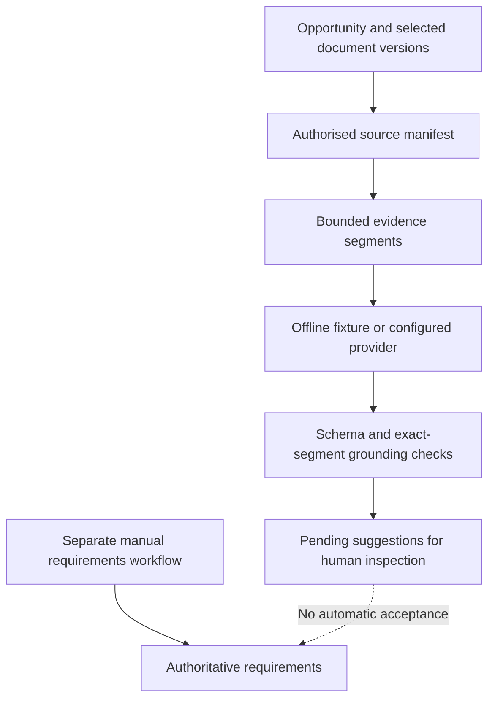

# Meridian Response Workspace

I developed Meridian to explore how a business can review opportunity requirements against the original emails, PDF documents and spreadsheets that produced them. The central design decision was to keep **source evidence**, **proposed interpretations** and **authoritative requirements** separate.

## The problem

A confident-looking AI summary can still be wrong. It might cite the wrong document version, combine unrelated passages, omit a conflicting requirement or turn a suggestion into a business decision without a person approving it.

I wanted the application to make these errors visible. The workflow follows a real business opportunity, retains immutable source versions and lets a reviewer inspect the evidence attached to each proposal.

## What I built

The workspace includes authenticated access, customers and contacts, opportunities and deadlines, received correspondence, private document versions, a manually maintained requirements register and an analysis-suggestion review screen.

The demonstration follows one fictional opportunity involving a technical requirements package. Its documents contain differing fuel-autonomy expectations and other matters for human clarification. The public videos demonstrate the application using a **deterministic offline fixture**, not a live model's accepted reasoning output.

## Engineering decisions

### 1. Freeze the source of every proposed finding

An analysis run selects specific evidence versions from one opportunity. The backend assembles bounded source segments from supported correspondence, text PDFs and spreadsheet cells. Each suggestion refers back to its run-specific source keys and locations. A newer document does not silently rewrite the evidence behind an earlier finding.

### 2. Validate citations in application code

The grounding layer does not simply accept references supplied by a model. It checks that each citation belongs to a selected source, references the correct source kind and page/cell/location, includes the required segment IDs in their expected order, and quotes a normalised excerpt that actually appears in those segments.

A missing segment, a spliced quotation or an incorrect page causes validation to fail. **This proves an excerpt can be located, not that the proposed interpretation is semantically correct.** That distinction is why the human review boundary matters.

### 3. Keep analysis suggestions away from approved records

Offline suggestions are stored as pending analysis results. The existing authoritative requirements register is maintained through separate manual workflows. The reviewed snapshot **does not implement accepting an AI suggestion directly into that register**. The demonstration presents cited suggestions for inspection; it does not claim an automated approval system.

### 4. Treat provider output as untrusted

The analysis pipeline bounds input and output, applies source allowlists, checks authorization again before persistence, sanitises failure details and avoids partial suggestions on failed completion. The application has an offline fixture provider and Ollama adapter code; neither provider is allowed to write authoritative requirements directly.

## Analysis and review boundaries

## What the demonstration actually proves

The documented final offline run completed successfully with **eight manually prepared fixture suggestions**. Their cited passages could be inspected against immutable source versions. This exercises the application flow—source selection, context assembly, validation, persistence and presentation—but it is **not a benchmark of autonomous extraction accuracy**.

I also explored local and cloud LLM integrations during development. The recorded final cloud acceptance did **not** pass: some generated citations were missing or mismatched, and the output failed the application contract. That result informed the decision to present the offline, deterministic evidence workflow rather than claim validated live-AI performance.

The repository includes tests for source isolation, malformed provider output, invented citations, excerpt mismatches, authorization, failed persistence and retry behaviour. Its recorded handover describes backend, frontend and browser verification; I reviewed the relevant source and tests but have not rerun the full suites in this portfolio review.

## What I would improve

Before enabling live AI as a reliable client feature, I would evaluate new unseen document sets, measure false findings and missed requirements, improve the model-to-citation output contract and run blind semantic reviews. I would also establish provider data-handling rules and production recovery procedures. I would keep human approval explicit even after improving model accuracy.

## Implementation

**Backend:** Python, FastAPI, SQLAlchemy, Alembic, Pydantic, private document storage and evidence validation.  
**Frontend:** React, TypeScript, Vite and a source-linked review interface.  
**AI integration:** offline deterministic fixture, Ollama provider adapter, bounded context construction and application-controlled grounding.

## Demonstration

[Watch the Meridian application demonstration](../../assets/media/meridian-demo.mp4) · [Watch the extended walkthrough](../../assets/media/meridian-detailed-walkthrough.mp4)

- [Opportunity overview](../../assets/media/meridian-response-screen-1.webp)
- [Source documents and versions](../../assets/media/meridian-response-screen-2.webp)
- [Pending suggestions](../../assets/media/meridian-response-screen-3.webp)
- [Inspecting evidence](../../assets/media/meridian-response-screen-4.webp)

Meridian's implementation is maintained privately by Ndlovu Business Technologies. The portfolio shares the engineering story and demonstrations without exposing the private source, credentials or documents.
