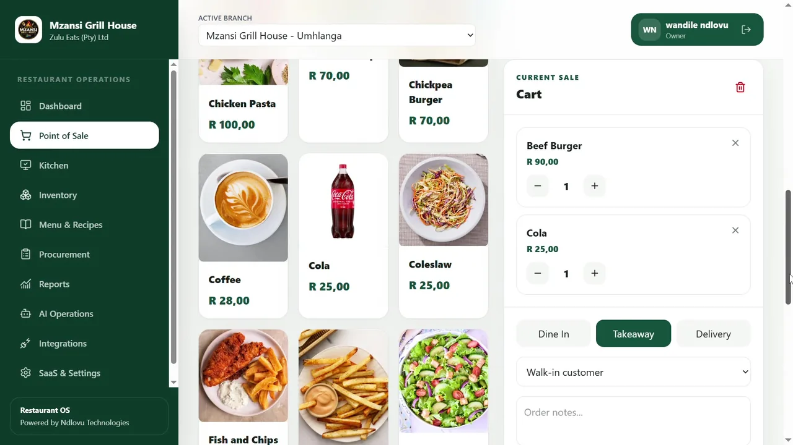
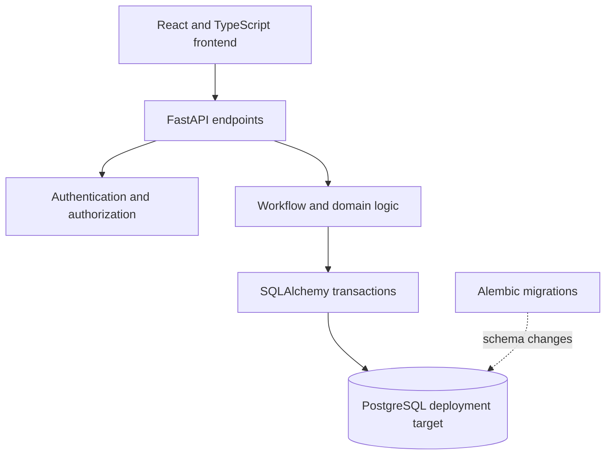

# Restaurant OS — Case Study

*Full-stack application · Independent project · Ndlovu Business Technologies*

## Why I built it

Running a restaurant involves several connected activities: taking orders, preparing food, accounting for stock, buying ingredients and understanding performance. Treating each activity as a separate screen is not enough. The actions need clear business rules and dependable records behind them.

I developed **Restaurant OS** as a full-stack application that brings point-of-sale, kitchen, inventory, procurement and reporting workflows into one system. I built it as an independent project to put these operational workflows into a working application and explore how to make the underlying records reliable.

[Watch the application demonstration](../../assets/media/restaurant-os-walkthrough.mp4) · [View the visual case study](index.html)

## How the application works

My recorded demonstration takes viewers through the operational screens:

- **Point of sale:** Menu selection, cart and checkout.
- **Kitchen:** Ticket board and order status progression.
- **Inventory:** Ingredient records, movements, transfers, counts, adjustments and receiving.
- **Recipes:** Stock behavior associated with menu items.
- **Procurement:** Suppliers, purchasing, receiving, invoices and payments.
- **Reporting:** Dashboard views and branch comparisons.

The video uses sample restaurant data.

## Architecture and technology

The frontend is built with **React, TypeScript and Vite**. It makes requests to a **FastAPI** backend, which handles request validation, access checks and business workflows. **SQLAlchemy** models relational data; the application's configured production database is **PostgreSQL**, with **Alembic** migrations for schema changes.

I kept business-critical validations on the backend rather than relying on browser screens to enforce data integrity. The repository also includes backend Pytest modules, frontend Vitest tests, GitHub Actions and Docker Compose deployment configuration.

## Engineering deep dive: maintaining inventory integrity across branches

The most useful example of the project's backend design is the **stock transfer workflow**.

A physical transfer is not a single quantity edit. One branch dispatches goods and another branch later confirms receipt. I represented this as explicit transitions:

`draft → submitted → approved → dispatched → received`

Permitted cancellation paths are also supported.

The dispatch handler accepts an approved transfer only. Before making a stock change, it checks the processing status, locks the transfer and relevant inventory rows, validates quantities and makes the outbound stock movement within the transaction. The receipt handler separately verifies that goods were dispatched, prevents a second receipt and records the inbound movement.

This matters because a duplicate click, a repeated API request or a partial failure must not silently create or remove stock twice.

### Source-backed test scenario

The repository contains a test at `backend/tests/launch/test_stock_transfer_lifecycle.py` that exercises the following behaviors:

| Action | Expected result in the test |
|---|---|
| Dispatch 4 units from 10 | Source stock becomes 6 |
| Repeat the dispatch | HTTP 409; no second deduction |
| Attempt to receive 5 | HTTP 409; rejected as an over-receipt |
| Receive 4 | Destination stock becomes 4 |
| Repeat the receipt | HTTP 409; no duplicate movement |
| Read a transfer from another company | HTTP 404; record not disclosed |

These are cases defined in the automated tests, not live customer metrics. GitHub Actions recorded a successful CI run on 26 September 2026.

### Access control

The backend compares the authenticated token's company and role claims to the current user record, and business-resource queries use company scoping. These checks are implemented in `backend/app/core/authorization.py` and relevant routers.

## What I would improve as the system scales

**Reduce controller complexity.** The stock-transfer router has grown beyond 2,300 lines. I would extract the business transitions and persistence rules into focused service modules, making the HTTP routes simpler to understand and easier to test.

**Test concurrency against PostgreSQL.** Some tests use SQLite fixtures. I would supplement them with concurrent PostgreSQL integration tests, especially for locks, retries and uniqueness constraints, because database behavior is not identical across engines.

**Expand CI coverage.** Frontend Vitest test files exist, but the inspected CI workflow runs frontend lint/build without executing `npm run test`. I would add that command to the verification pipeline.

**Harden browser session design.** The frontend currently stores bearer tokens in `localStorage`. I would compare the current approach with HttpOnly cookie-based sessions and evaluate CSRF protections as part of the security design.

## Technology summary

**Backend:** Python, FastAPI, SQLAlchemy  
**Frontend:** React, TypeScript, Vite  
**Database:** PostgreSQL, Alembic  
**Verification and deployment tooling:** Pytest, Vitest, GitHub Actions, Docker Compose

**Project status:** Independent application demonstrated with sample data; not a customer deployment.

**Relevant implementation files (private company repository):**

- `backend/app/routers/stock_transfer.py`
- `backend/app/models/stock_transfer.py`
- `backend/app/models/stock_transfer_item.py`
- `backend/tests/launch/test_stock_transfer_lifecycle.py`
- `backend/app/core/authorization.py`
- `.github/workflows/ci.yml`

The implementation is maintained in Ndlovu Business Technologies’ private repository. This case study includes the workflow, design decisions and supporting demonstrations without distributing the complete source code.
