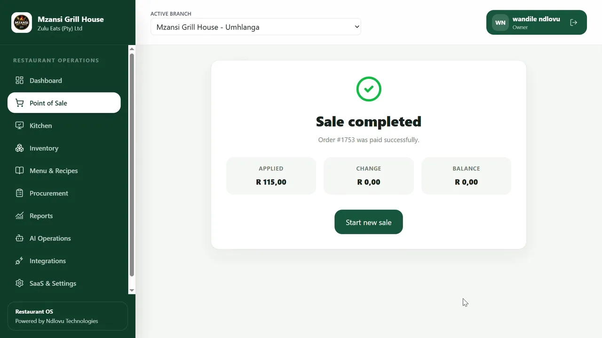
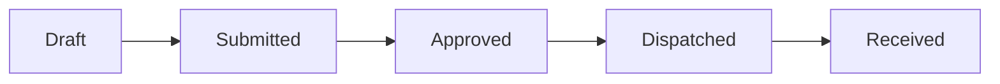

# Restaurant OS

**A full-stack restaurant operations application I developed through Ndlovu Business Technologies.**

Restaurant OS brings point-of-sale, kitchen, inventory, procurement and reporting workflows into a connected application. I built it to explore connected business workflows, with particular attention to how the backend handles inventory movements and data consistency.

[**View the visual case study →**](index.html) · [**Watch the demonstration →**](../../assets/media/restaurant-os-walkthrough.mp4) · [**Read the technical write-up →**](CASE_STUDY.md)

## Application demonstration

The walkthrough uses sample restaurant records.

## My engineering focus

I paid particular attention to the branch stock-transfer lifecycle. The implementation uses explicit state transitions, quantity validation, row locking, transaction boundaries and movement records to avoid repeated stock mutations.

The test `backend/tests/launch/test_stock_transfer_lifecycle.py` covers duplicate dispatch and receipt, invalid received quantities and cross-company record access. [See the evidence and trade-offs](CASE_STUDY.md#engineering-deep-dive-maintaining-inventory-integrity-across-branches).

## Technical architecture

| Layer | Implementation |
|---|---|
| Frontend | React, TypeScript, Vite |
| HTTP/API | Python, FastAPI |
| Data model | SQLAlchemy |
| Database | PostgreSQL production configuration; Alembic migrations |
| Tests and automation | Pytest, Vitest, GitHub Actions |
| Deployment tooling | Docker Compose and operational scripts |

## Example API endpoints

The source repository contains these endpoints (they are not publicly callable through this portfolio):

| Method | Endpoint | Role |
|---|---|---|
| `POST` | `/auth/login` | Authenticate |
| `GET` | `/auth/me` | Read current authenticated user |
| `POST` | `/stock-transfers` | Create a transfer |
| `POST` | `/stock-transfers/{id}/submit` | Submit draft |
| `POST` | `/stock-transfers/{id}/approve` | Approve quantities |
| `POST` | `/stock-transfers/{id}/dispatch` | Process outbound stock |
| `POST` | `/stock-transfers/{id}/receive` | Record inbound stock |

## Tests and development status

- The private repository contains backend Pytest tests, frontend Vitest test files and GitHub Actions CI.
- The inspected CI pipeline runs backend tests and frontend lint/build; frontend Vitest is not currently executed by that workflow.
- The latest observed CI run passed on 26 September 2026.
- This is an independent demonstration project, not a live client installation.

## Source code and setup

The application source is held in a private Ndlovu Business Technologies repository. This project page shares the case study and demonstration rather than a runnable copy. For that reason, this folder does not include backend installation commands, environment variables or test credentials.

To view the portfolio locally, download the containing portfolio folder and open `../../index.html`, or open [the Restaurant OS case study](index.html). Environment configuration and installation instructions belong to the privately maintained application repository, not this documentation-only showcase.

## Reflections

My next priorities would be smaller domain services, PostgreSQL concurrency tests, frontend tests in CI and a threat-model review of browser token storage. I discuss each in the [technical case study](CASE_STUDY.md#what-i-would-improve-as-the-system-scales).
